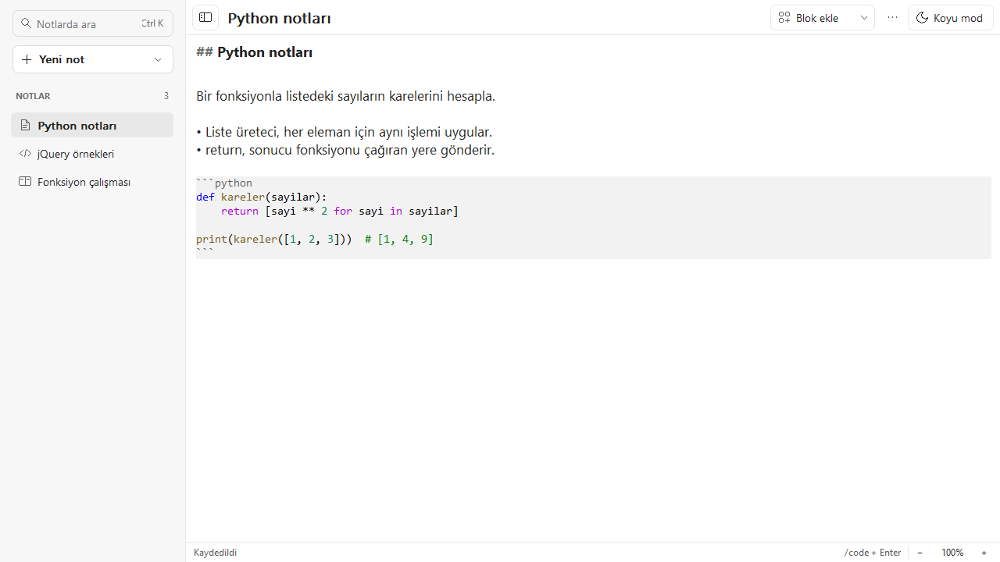
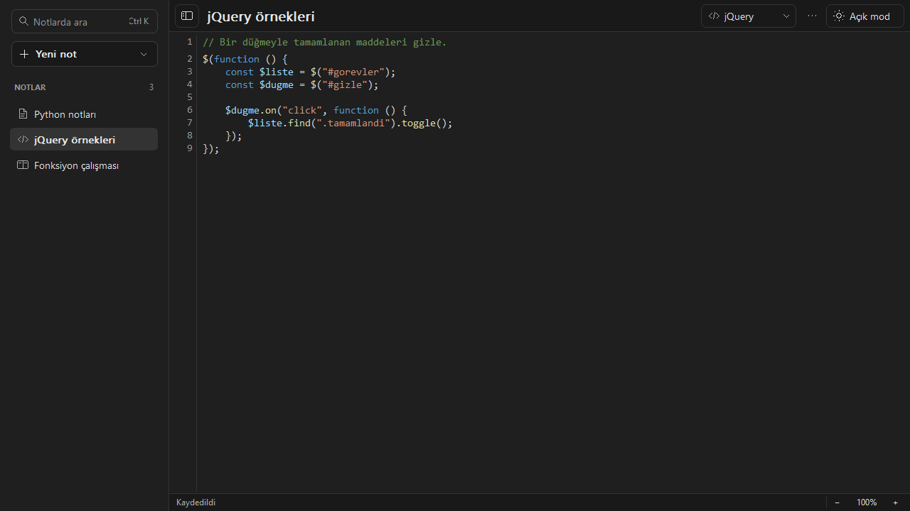
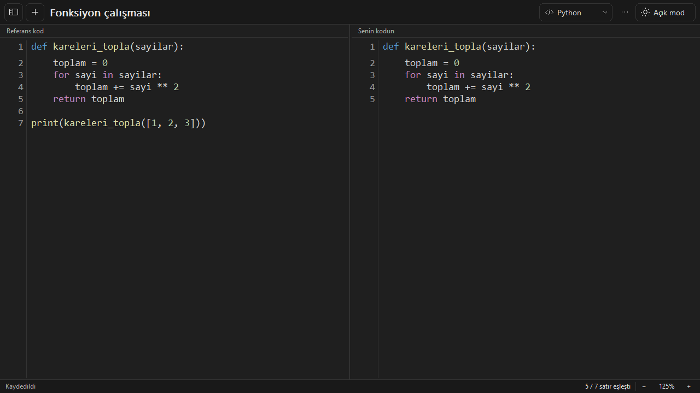

# Defter

Defter, Windows için tek EXE olarak çalışan hafif bir not ve kod defteri. Metin notları, kod notları ve iki panelli kod çalışması aynı defterde durur.

**[Windows x64 için Defter.exe’yi indir](https://github.com/arafcode/defter/releases/latest/download/Defter.exe)**

## Kullanım

- **Metin notu.** Başlık, liste ve yapılacaklar ekle. Boş satıra `/code python` yazıp Enter’a basarak not içinde kod bloğu aç.
- **Kod notu.** Dil seçerek satır numaraları ve VS Code Light+ / Dark+ paletleriyle yaz. jQuery, dil menüsünde JavaScript’in yanında.
- **Kod çalışması.** Referansı sol panele yapıştır, sağ panelde kendin yaz. Alt çubuk eşleşen satırları gösterir.

| Kısayol | İşlem |
| --- | --- |
| Ctrl+N | Metin notu aç |
| Ctrl+Shift+N | Kod notu aç |
| Ctrl+Alt+N | Kod çalışması aç |
| Ctrl+K | Notlarda ara |
| F11 | Tam ekrana gir veya çık |
| Ctrl+fare tekerleği, Ctrl+artı veya Ctrl+eksi | Yakınlaştır veya uzaklaştır |
| Ctrl+0 | Yakınlaştırmayı %100’e getir |
| Shift+fare tekerleği | Kodda yatay kaydır |

Notlar otomatik olarak `%LOCALAPPDATA%\Defter` klasöründe saklanır.

## Ekran görüntüleri

### Metin notu ve Python bloğu



### Koyu temada jQuery kod notu



### İki panelli kod çalışması



## Kaynaktan derleme

Windows’ta MSVC x64 araçları ve Windows SDK bileşenleriyle Visual Studio 2022 Build Tools’u kur. Repo klasöründe aşağıdaki komutu çalıştır.

```bat
build.bat
```

Çıktı `build\Defter.exe` yolunda oluşur. Uygulama C++20, Win32 ve Windows’un yerel Rich Edit bileşenini kullanır.
